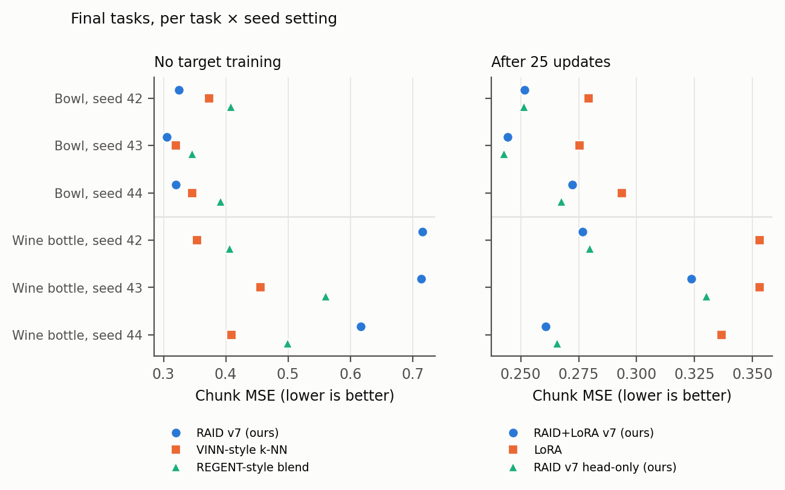
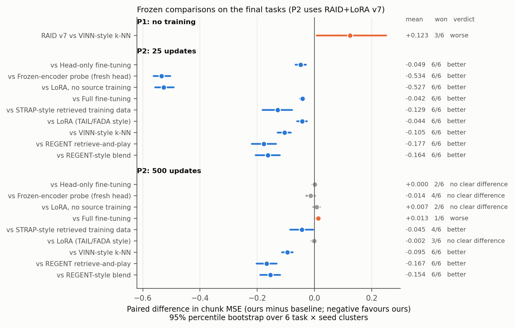
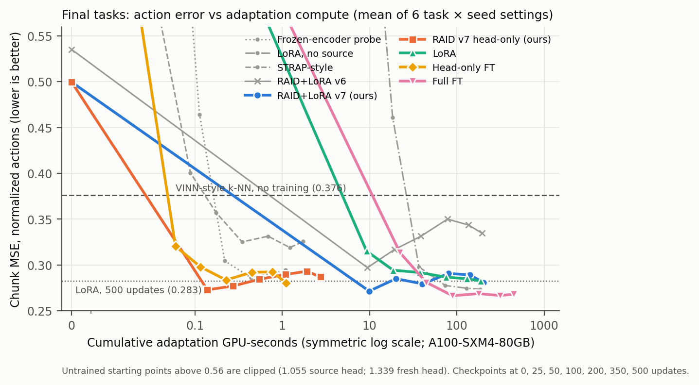
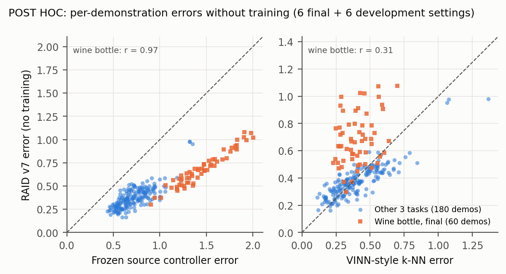

# Retrieval Accelerates but Does Not Replace Few-Shot Adaptation of Visual Inverse Dynamics: An Action-Error–Compute Benchmark on LIBERO-Goal

> Status: results manuscript, 18 October 2026. Written from collected artifacts only; no new experiments. Reconciled with the [Google Doc](https://docs.google.com/document/d/11QDjW49qwxiZFJGYxMB5_dELf5keka6Qeh3ijXpW10s) on 18 October 2026: its content matched the 11 October version, so no user edits had to be merged. The Google Doc was then replaced in place with this text (same link) and verified by readback; figure images still have to be inserted there by hand. `held_out_claims_eligible = false`: the final tasks were never used for design, but we cannot verify that the video generator used in the closed-loop pilot (VPP2) never saw LIBERO data, so no claim of generator-unseen tasks is made.

Constantin Ertel¹, Phillip Kerger¹

¹ University of California, Berkeley

*Working manuscript | Protocol v6 with frozen final-analysis amendment 1b42ba59 | Revised 18 October 2026*

## Abstract

Video-planning robot controllers translate a predicted future frame into actions with an inverse-dynamics model (IDM). When a new task supplies only a few demonstrations, the IDM must adapt, and the cost of that adaptation matters alongside its accuracy. We study few-shot IDM adaptation on held-out LIBERO-Goal tasks and measure action error (chunk mean-squared error on normalized actions, and R²) against adaptation compute (GPU-seconds and FLOPs per update). Our method, RAID, is a retrieval-augmented IDM whose head attends over 16 support transitions retrieved in a frozen reference space and gates the resulting prior against a direct prediction. We compare it with nine re-implemented baselines covering nearest-neighbour action regression, retrieve-and-blend prediction, retrieved training data, head-only and full fine-tuning, LoRA, and frozen-encoder probes. After development on two tasks, we froze the method set, comparisons and decision rule, and then ran once on two sealed tasks with three seeds. Without target training, RAID was worse than VINN-style k-nearest-neighbour regression (MSE 0.500 vs 0.376), so the first frozen comparison failed. After 25 updates, RAID with LoRA (0.272) had lower error than all nine baselines in all six task–seed settings. After 500 updates it showed no clear difference from head-only, LoRA and probe baselines and was worse than full fine-tuning (0.268). An exploratory frozen-encoder variant of RAID reached LoRA's 500-update error after about 0.14 GPU-seconds, whereas LoRA needed about 190. A post hoc analysis links the zero-training failure to one task on which the source-trained direct prediction is far outside its usual error range and the learned gate does not fall back to retrieval. A 40-episode closed-loop pilot with a frozen video generator yields low success for all conditions (0–2 of 10) and is reported only as secondary evidence. Retrieval therefore accelerates, but does not replace, few-shot IDM adaptation.

Keywords: inverse dynamics; few-shot adaptation; retrieval; LoRA; adaptation compute; visual planning; robot learning.

## 1. Introduction

Visual world models make possible futures available as images or video, but a visual proposal must still be translated into executable robot actions. UniPi connects text-conditioned video planning with a separately trained inverse-dynamics model [1](https://arxiv.org/abs/2302.00111). More recent systems retain this decomposition: π0.7 conditions a generalist controller on visual subgoals [2](https://arxiv.org/abs/2604.15483), OpenWAM supports composable visual-prediction and inverse-dynamics components [3](https://arxiv.org/abs/2610.07922), and GE-Act 2.0 and VPP2 couple a visual planner with an action module [4](https://arxiv.org/abs/2609.05588),[5](https://arxiv.org/abs/2610.10270). When the visual predictor stays fixed, task-specific knowledge must enter through the action-inference component. This paper studies how that component, an inverse-dynamics model (IDM) that maps the current observation, robot state and a target future frame to an action chunk, should adapt to a new task from five demonstrations.

With few target demonstrations, an IDM can use the demonstrations at prediction time, as in nearest-neighbour regression and retrieval-augmented policies [6](https://arxiv.org/abs/2112.01511),[7](https://arxiv.org/abs/2412.04759); it can use them to select additional training data [8](https://arxiv.org/abs/2304.08742),[9](https://arxiv.org/abs/2412.15182); or it can update parameters, from an action head alone to low-rank adapters [10](https://proceedings.iclr.cc/paper_files/paper/2024/hash/46e2b525da536030ec1589dddea01feb-Abstract-Conference.html),[11](https://arxiv.org/abs/2606.28476v1),[12](https://arxiv.org/abs/2106.09685) and full fine-tuning. These options differ sharply in cost. Retrieval needs no target training but adds lookup at inference. Head-only training on cached frozen features is cheap. LoRA and full fine-tuning run the image encoder at every update. Comparisons that report only accuracy after a fixed number of updates hide this difference.

We therefore treat few-shot IDM adaptation as a measurement problem: action error on held-out recorded transitions as a function of adaptation compute. The primary metric is chunk mean-squared error on normalized actions, averaged over query demonstrations, together with R²; compute is measured in adaptation GPU-seconds, FLOPs per update, trainable parameters and per-decision cost. Task success is secondary evidence. End-to-end few-shot policies are much stronger on success: in DISC's five-demonstration LIBERO-Goal evaluation, reported success at the best checkpoint is 55.0% for Octo, 68.5% for VQ-BeT and 73.0% for DISC [13](https://arxiv.org/abs/2605.20856),[14](https://arxiv.org/abs/2405.12213),[15](https://arxiv.org/abs/2403.03181), under a protocol different from ours. Our closed-loop pilot reaches at most 2 of 10 episodes. We do not compete on task success, and offline action error is not a substitute for it.

Our method, RAID (Retrieval-Augmented Inverse Dynamics), retrieves the 16 support transitions closest to the query in a frozen reference representation. A learned head attends over the retrieved action chunks and mixes the resulting prior with a direct prediction through a per-dimension gate. Retrieval keys always come from the frozen reference encoder, so adapting the controller encoder with LoRA never changes the geometry of the support bank. Neither retrieval combined with LoRA nor a new world–action-model architecture is a sufficient novelty claim: ReCAP adds trajectory retrieval to a frozen world–action policy [16](https://arxiv.org/abs/2606.15631), HAND retrieves robot experience and then fine-tunes a policy [17](https://arxiv.org/abs/2505.20455v4), and VLA-Pro retrieves and fuses task-specific LoRA adapters [18](https://arxiv.org/abs/2605.29562v1). Our contribution is a controlled measurement of when retrieval helps an adapting IDM and what it costs.

The protocol separates design from evaluation. All method development used two development tasks. We then froze the method set, comparisons, interval method and decision rule in a digest-bound amendment before any final-task file was read, and ran the frozen benchmark once on two sealed final tasks with three seeds. Two of our variants were designed after development results were known; development data were therefore used for design, but final-task data were not. Throughout, `held_out_claims_eligible = false`: the final tasks are held out from our training and design, but we make no claim that LIBERO is unseen by the pretrained models in the pipeline.

Our contributions are:

1. **A compute-aware few-shot IDM benchmark on LIBERO-Goal.** Fifteen methods, six training-free and nine trained, are evaluated on the same support sets, query transitions, normalizers and update schedule, and each trained method yields an error-versus-GPU-second curve. The nine baselines are re-implementations of established method families in our setting, not reproductions of the published systems.
2. **The RAID v7 head and a frozen-encoder variant.** Cross-attention over k = 16 retrieved candidates, a per-dimension gate and an auxiliary selection loss; the head can be combined with encoder LoRA or trained alone on cached frozen features.
3. **A frozen-plan final evaluation that includes a failed comparison.** Without training, RAID is worse than VINN-style k-NN. After 25 updates, RAID with LoRA is better than all nine baselines in 6/6 settings. After 500 updates the advantage disappears, and full fine-tuning is best.
4. **A post hoc diagnosis of the zero-training failure**, clearly separated from the frozen analysis.
5. **A small closed-loop pilot** with a frozen video generator, reported as secondary evidence.

## 2. Related Work

### 2.1 Video planning with inverse dynamics

Video planning followed by action inference has substantial precedent. UniPi uses a separately trained inverse model [1](https://arxiv.org/abs/2302.00111). π0.7 employs visual subgoal conditioning, treats the resulting action prediction as an inverse-dynamics-like problem, and trains with both real and generated subgoals [2](https://arxiv.org/abs/2604.15483). OpenWAM defines local dynamics interfaces from the current observation, proprioception and a supplied future, and studies reuse of an inverse model with adapted visual predictors [3](https://arxiv.org/abs/2610.07922). GE-Act 2.0 connects visual planning and inverse dynamics with an explicit mechanism for aligning generated futures with action supervision [4](https://arxiv.org/abs/2609.05588), and VPP2 distills a video model into a visual planner with an action module [5](https://arxiv.org/abs/2610.10270). Other world–action models couple video and actions more tightly: DreamZero models them jointly [19](https://arxiv.org/abs/2602.15922), and Cosmos 3 supports several visual and action input–output configurations [20](https://arxiv.org/abs/2606.02800). Fast-WAM questions whether test-time future imagination is needed at all [21](https://arxiv.org/abs/2603.16666), and RoboWM-Bench and EVA judge visual predictions through execution rather than appearance [22](https://arxiv.org/abs/2604.19092),[23](https://arxiv.org/abs/2603.17808). Inverse dynamics also supports learning from observation [24](https://arxiv.org/abs/1805.01954), predictive robot models [25](https://arxiv.org/abs/2412.15109v1) and policy supervision from synthetic video [26](https://arxiv.org/abs/2505.12705v2); its label efficiency depends on the setting [27](https://arxiv.org/abs/2602.02762). We fix the visual predictor and study only how the IDM adapts.

### 2.2 Retrieval as an action predictor

VINN separates representation learning from behavior learning and predicts actions by locally weighted nearest-neighbour regression [6](https://arxiv.org/abs/2112.01511). REGENT retrieves demonstrations and combines them with a learned transformer policy, including a retrieve-and-play baseline and a distance-weighted interpolation between the retrieved action and the model output, so that it can act in new environments without mandatory fine-tuning [7](https://arxiv.org/abs/2412.04759). RT-Cache retrieves and replays action snippets from visual memory [28](https://arxiv.org/abs/2505.09040v3), CLAW maps latent actions to executable controls through nearest-neighbour lookup [29](https://arxiv.org/abs/2606.04130v1), and RAEA integrates retrieved experience through cross-attention [30](https://arxiv.org/abs/2404.11699v1). ReCAP adds trajectory retrieval to Cosmos Policy and extends task coverage by adding demonstrations while the policy stays frozen [16](https://arxiv.org/abs/2606.15631). Our training-free baselines re-implement three of these mechanisms: VINN-style weighted k-NN, REGENT retrieve-and-play and a REGENT-style blend. RAID differs in that a learned head selects among retrieved candidates and gates them against a direct prediction, and in that we combine it with target-time parameter updates inside a separate IDM.

### 2.3 Retrieval for training data

Retrieval can also select training data. Behavior Retrieval queries unlabeled prior data for few-shot imitation [8](https://arxiv.org/abs/2304.08742), FlowRetrieval uses optical flow to guide retrieval [31](https://proceedings.mlr.press/v270/lin25a.html), STRAP retrieves sub-trajectories to augment policy training [9](https://arxiv.org/abs/2412.15182), and importance-weighted retrieval corrects the retrieval distribution [32](https://arxiv.org/abs/2509.01657v1). HAND retrieves robot experience by hand path and fine-tunes a policy on it [17](https://arxiv.org/abs/2505.20455v4). Our STRAP-style baseline mixes support transitions with their nearest source-task transitions during head training; retrieval then affects only the training data, not the prediction.

### 2.4 Parameter-efficient adaptation

LoRA freezes the original weights and learns an additive low-rank update [12](https://arxiv.org/abs/2106.09685). TAIL evaluates LoRA and other lightweight adapters for continual robot imitation [10](https://proceedings.iclr.cc/paper_files/paper/2024/hash/46e2b525da536030ec1589dddea01feb-Abstract-Conference.html), and FADA adapts inverse dynamics behind a frozen planner [11](https://arxiv.org/abs/2606.28476v1); our LoRA baseline follows this family. OpenVLA studies efficient policy fine-tuning [33](https://arxiv.org/abs/2406.09246v3), and OpenVLA-OFT shows that action representation, chunking, decoding and the training objective affect both performance and inference cost [34](https://arxiv.org/abs/2502.19645v2), which motivates measuring resources rather than counting parameters alone. WIZARD [35](https://arxiv.org/abs/2606.07217v1), VLA-Pro [18](https://arxiv.org/abs/2605.29562v1) and FOCA [36](https://arxiv.org/abs/2606.20867v1) investigate other adaptation mechanisms; VLA-Pro in particular retrieves and fuses LoRA adapters, whereas RAID retrieves labeled visual transitions. RoboTTT uses test-time learning over robot context [37](https://arxiv.org/abs/2607.15275), and retrieval/fine-tuning hybrids also appear in language-model-based world modeling [38](https://arxiv.org/abs/2610.02542). These precedents rule out a broad novelty claim for combining memory and parameter updates.

### 2.5 Frozen representations and probes

Pretrained encoders supply the representation for inverse dynamics. MAE learns image features through masked reconstruction [39](https://arxiv.org/abs/2111.06377), R3M studies frozen representations for manipulation [40](https://arxiv.org/abs/2203.12601v3), and VC-1 shows that frozen-representation quality varies across embodied tasks and adaptation settings [41](https://arxiv.org/abs/2303.18240v2). Our frozen-encoder probe (a freshly initialized head on frozen MAE features) and head-only fine-tuning belong to this protocol family. We also distinguish the controller representation, which LoRA may change, from the frozen reference representation used for retrieval keys and queries.

### 2.6 End-to-end few-shot policies

End-to-end policies adapt an entire visuomotor policy and report task success. DISC generates task-specific policy parameters from instructions and, in its five-demonstration LIBERO-Goal evaluation, reports success at checkpoints between 50 and 1,000 adaptation steps of 15.5–68.5% for VQ-BeT, 16.0–55.0% for Octo and 60.0–73.0% for DISC, with Diffusion Policy at or below 1.5% [13](https://arxiv.org/abs/2605.20856),[14](https://arxiv.org/abs/2405.12213),[15](https://arxiv.org/abs/2403.03181),[42](https://arxiv.org/abs/2303.04137). These numbers come from a different task split, pretraining set and evaluation protocol and are not matched baselines. We cite them to position our work: we study the IDM component of a modular pipeline and its adaptation cost, and we make no claim of competitive task success.

## 3. Problem Formulation

**Tasks and data.** LIBERO-Goal contains ten tasks that share objects and layout but differ in their goals, with 50 demonstrations each [43](https://arxiv.org/abs/2306.03310). We use a fixed split into six source tasks, two development tasks and two final tasks (Appendix A, Table A1). For each target task, 30 demonstrations form a support pool and 20 form the query set. A support seed s ∈ {42, 43, 44} selects K = 5 support demonstrations from the pool; the same seed also seeds source training. One (task, seed) pair is a *setting*; each stage has 2 tasks × 3 seeds = 6 settings.

**Inverse-dynamics interface.** At time t the IDM receives the current RGB observation oₜ, the future observation oₜ₊ₕ with H = 8, the current proprioception qₜ (7 joint positions and 2 gripper positions, normalized with source-training statistics) and the requested duration H. It predicts an action chunk âₜ:ₜ₊₇ ∈ ℝ^{8×7} in the LIBERO action convention, normalized per dimension with source-training statistics.

**Offline evaluation (primary).** Every stride-1 window of each query demonstration is evaluated with the recorded future frame oₜ₊₈ and its logged action chunk. The error of a window is the mean squared error over the 56 normalized action elements. Errors are averaged within each query demonstration, then over the 20 query demonstrations (macro average); we report the mean over the six settings. R² is the mean over the seven action dimensions of 1 − SSE/SST over all query chunk elements. Because the future frame is recorded, this setting measures action inference given a correct future and is not affected by generator quality.

**Adaptation compute.** For each trained method we record the error after n ∈ {0, 25, 50, 100, 200, 350, 500} updates and the cumulative adaptation GPU-seconds C(n): synchronized wall-clock time of the updates on one GPU, excluding evaluation. We also record FLOPs per update (forward and backward pass, batch 64), trainable parameters, and the latency, FLOPs and peak memory of one control decision at batch size 1. One-time costs shared by all methods (source training and the frozen feature cache) are reported separately and are not included in C(n).

**Closed-loop evaluation (secondary).** A frozen video generator receives the current RGB frame and the instruction and returns a clip; the IDM converts frames of that clip into action chunks that are executed in the simulator. The outcome is unfiltered task success. Logged actions from a different trajectory are not ground truth for an arbitrary generated future, so closed-loop success and offline error answer different questions.

## 4. Method

### 4.1 Pipeline

The pipeline has a frozen visual generator and an IDM. The generator is conditioned only on the current RGB frame and the instruction; recorded futures, logged actions, privileged simulator state and native generator actions are excluded from the controller input. In the offline benchmark the generator is not used. In the closed-loop pilot it is the standalone Stage-1 video model of VPP2 [5](https://arxiv.org/abs/2610.10270), pinned to a fixed repository commit; earlier feasibility tests with Cosmos3-Edge [44](https://huggingface.co/nvidia/Cosmos3-Edge) are not part of the reported results.

### 4.2 Controller, frozen reference retrieval and source training

The controller encoder φ is an MAE ViT-B/16 [39](https://arxiv.org/abs/2111.06377); its 768-dimensional normalized CLS features of oₜ and oₜ₊ₕ, together with qₜ and H, form the state s. A separate frozen copy φ_ref produces the retrieval keys and queries. A support bank stores, for every support window, φ_ref(oₜ), φ_ref(oₜ₊ₕ), qₜ, H, the normalized action chunk and the parent demonstration. The retrieval distance is

d = 0.5 (1 − cos(φ_ref(oₜ), φ_ref(o′ₜ))) + 0.5 (1 − cos(φ_ref(oₜ₊ₕ), φ_ref(o′ₜ₊ₕ))) + 0.1 · mean((qₜ − q′ₜ)²),

with exact duration matching; similarity is −d. Because keys are always computed with φ_ref, controller adaptation cannot invalidate the bank.

One source controller per head type and seed is trained on the six source tasks (40 training, 5 validation and 5 retention demonstrations per task) for 2,000 updates with batch 64, AdamW (learning rate 3·10⁻⁴, weight decay 10⁻⁴) and gradient clipping at 1.0. The objective averages a retrieval-present loss and a masked-memory (null-retrieval) loss with equal weight. For the retrieval-present term, each query retrieves from an episodic bank of 2, 5 or 10 demonstrations of the same source task, excluding the query's own demonstration. The checkpoint with the lowest source-validation error, evaluated every 100 updates, is kept.

### 4.3 RAID v6: retrieval block and MLP

RAID v6 appends a fixed-width retrieval block to the controller input: four similarity-sorted neighbour slots, each holding a normalized action chunk, its similarity and a validity flag, followed by their softmax-weighted mean (temperature 0.1). Missing neighbours are masked, and an empty bank yields a finite null block. A three-layer MLP (hidden widths 512 and 256, LayerNorm, ReLU, dropout 0.1) maps the input to the action chunk.

### 4.4 RAID v7: attention over retrieved candidates with a per-dimension gate

RAID v7 retrieves k = 16 candidates with the same frozen-reference distance and computes

direct = f_θ(s),\
αᵢ = softmax_i( (W_q s) · (W_k [φ̂_ref(oⁱₜ), φ̂_ref(oⁱₜ₊ₕ), simᵢ]) / √128 ) over valid candidates,\
prior = Σᵢ αᵢ aⁱ,\
g = σ(W_g s) ∈ (0, 1)⁵⁶,\
â = g ⊙ direct + (1 − g) ⊙ prior,

where f_θ is the MLP trunk of §4.3, φ̂ denotes L2-normalized features, aⁱ is the normalized action chunk of candidate i, and the gate is set to g = 1 when no candidate is valid (null memory). During training, Gaussian noise with standard deviation 0.05 is added to candidate actions. An auxiliary selection loss pulls attention toward candidates whose actions match the target,

L_sel = KL(w\* ‖ α), w\*ᵢ ∝ exp(−mse(aⁱ, a)), restricted to valid candidates,

applied with weight 0.1 when at least two candidates are valid, both in source training and in adaptation. Retrieval enters the head as candidate keys and values rather than as a fixed input block, so the head can learn which candidates to trust and, through the gate, how much to trust retrieval at all.

### 4.5 Target adaptation

All trained methods use the same five support demonstrations, normalizers, 500-update schedule, batch size 64, sampler seed stream, optimizer settings (AdamW; head learning rate 3·10⁻⁴; adapter learning rate 10⁻⁴; weight decay 10⁻⁴; gradient clip 1.0) and checkpoints.

**LoRA.** Rank-8, α = 16 LoRA (dropout 0) on the qkv and output projections of MAE blocks 10 and 11, plus the source-trained head; the adapter is inserted with zero initial effect. LoRA receives null memory.

**RAID+LoRA.** The same LoRA and head updates with retrieval active during adaptation and evaluation. During adaptation, each support query excludes its entire parent demonstration from the bank, so it retrieves from the other four demonstrations; at evaluation it retrieves from all five. Controller features come from the LoRA-adapted encoder and retrieval keys from φ_ref, so each decision needs two image encodings. RAID+LoRA v6 and RAID+LoRA v7 differ only in the head.

**RAID v7 head-only (exploratory).** The encoder stays frozen and features are cached. Only the RAID v7 head (trunk, attention and gate; 1,420,832 parameters) is trained, with the same retrieval exclusion and the same schedule and sample stream as head-only fine-tuning. This variant was defined after the development results were known.

## 5. Experimental Design

### 5.1 Methods

Table 1 lists all fifteen methods. The baselines re-implement the core mechanism of each family with our encoder, inputs, normalizers and schedule. They are not reproductions of the published systems, and their numbers must not be read as the published methods' performance.

<!-- Source: raid_experiments/hybrid_baselines.py; raid_experiments/hybrid_v7.py; raid_experiments/hybrid_compute_bench.py; trainable parameters from artifacts/raid_hybrid_libero_goal_v6/compute_bench_final_20261017/FINAL_RESULTS.md -->

Table 1. Methods. "Source head" means initialization from the source-trained controller; "fresh" means random initialization. Trainable parameters are for target adaptation.

| Method | Family | Encoder during adaptation | Head init | Retrieval at prediction | Trainable params |
| --- | --- | --- | --- | --- | --- |
| Frozen source controller | — | — | source | no | 0 |
| RAID v6 (ours) | retrieval block + MLP | — | source | yes (k = 4) | 0 |
| RAID v7 (ours) | attention + gate | — | source | yes (k = 16) | 0 |
| VINN-style k-NN | weighted k-NN [6] | — | — | similarity-weighted mean, k = 4, T = 0.1 | 0 |
| REGENT retrieve-and-play | [7] | — | — | nearest action chunk | 0 |
| REGENT-style blend | [7] | — | source | w·nearest + (1 − w)·source head, w = exp(−10 d) | 0 |
| Head-only fine-tuning | frozen-feature fine-tuning | frozen | source | no | 1,087,288 |
| Frozen-encoder probe | probe [39–41] | frozen | fresh | no | 1,087,288 |
| LoRA, no source training | from-scratch IDM | LoRA | fresh | no | 1,161,016 |
| Full fine-tuning | — | all weights (lr 10⁻⁵) | source | no | 86,885,944 |
| STRAP-style retrieved data | [8, 9] | frozen | source | no (retrieval selects half of each batch from source tasks) | 1,087,288 |
| LoRA (TAIL/FADA style) | [10, 11] | LoRA | source | no | 1,161,016 |
| RAID+LoRA v6 (ours) | — | LoRA | source | yes (k = 4) | 1,161,016 |
| RAID+LoRA v7 (ours) | — | LoRA | source | yes (k = 16) | 1,494,560 |
| RAID v7 head-only (ours, exploratory) | — | frozen | source | yes (k = 16) | 1,420,832 |

The VINN-style baseline uses the frozen MAE reference space rather than VINN's own self-supervised encoder. The STRAP-style baseline retrieves the four nearest source-task windows for every support window from the training demonstrations of all six source tasks, in the frozen reference space, and fills half of each batch with these retrieved windows.

### 5.2 Offline benchmark

Each setting evaluates every method on the 20 query demonstrations of one target task with recorded future frames. Trained methods are evaluated at all seven checkpoints. Source controllers are bitwise identical across runs with the same seed: an exploratory rerun reproduced the training-free methods and every head-only checkpoint of the earlier development run exactly (largest per-demonstration difference 0.0), which allows the exploratory RAID v7 head-only results to be paired with that run.

### 5.3 Compute measurement

All methods of a run share one GPU and 16 CPU threads. Adaptation GPU-seconds exclude evaluation, and FLOPs are counted with PyTorch's FLOP counter. Decision cost is measured at batch size 1 and includes encoding the current and future frames, a second encoding with φ_ref when the controller encoder is adapted and retrieval is active, retrieval, and the head. On the final run (NVIDIA A100-SXM4-80GB), the one-time reference feature cache took 119 s, and source training took 279–301 s per head type and seed for 2,000 updates. These shared costs are excluded from C(n); they exceed the entire adaptation cost of the frozen-encoder methods by two orders of magnitude but are amortized across target tasks. Development benchmarks ran on different A100 variants, so we compare GPU-seconds only within a run.

### 5.4 Development, frozen plan and final run

Development used only the two development tasks: a compute-aware benchmark of v6 and v7 (16–17 October 2026), the nine-baseline benchmark (17 October), and the exploratory RAID v7 head-only run (17 October). On 17 October 2026 at 20:15 UTC, before any final-task data were hashed, packaged or read, we froze an analysis amendment (SHA-256 digest 1b42ba59…) that fixes the method set, metrics, checkpoints and the following comparisons:

- **P1:** RAID v7 without training versus the best training-free baseline on development data (VINN-style k-NN, development MSE 0.426).
- **P2:** the RAID variant with the lowest development error at each budget versus each of the nine baselines, at 25 and at 500 updates. The rule selected RAID+LoRA v7 at both budgets (development MSE 0.308 and 0.290).
- **P3 (descriptive):** error at fixed budgets of 0.1, 0.5, 1, 10 and 100 GPU-seconds (last checkpoint within the budget), and GPU-seconds to reach LoRA's 500-update error.

For each comparison we compute the paired difference (ours minus baseline) per query demonstration. The primary 95% interval is a percentile bootstrap over the six task × seed clusters (10,000 resamples, seed 0); we also report a demonstration-level interval and the number of settings won out of six. The decision rule is *better* if the cluster interval lies entirely below zero, *worse* if entirely above zero, and *no clear difference* otherwise. No multiplicity correction is applied. With only six clusters, a percentile bootstrap can be too narrow, so the interval should be read together with settings won.

The final run evaluated the two sealed tasks with seeds 42, 43 and 44 once. Its package contained only source and final tasks, final-task access was gated by the frozen amendment, and nothing was tuned afterwards. The final stage has been used and will not be rerun.

### 5.5 Closed-loop pilot

The closed-loop pilot preceded the v7 design and therefore evaluates the four original conditions: frozen source controller, RAID v6, LoRA and RAID+LoRA v6. It used the two development tasks, seed 42 and five recorded initial states per task, giving 40 episodes. For each plan, VPP2 generated one clip from the current frame and a structured scene prompt written by a language model (two candidate prompts and a language-model judge); frames 9 and 18 of the clip served as targets for two 8-step chunks before replanning from the condition's own observation, up to 300 steps. The first plan of each case was shared by all four conditions. We waived a planned 15-case human-rating gate for generated clips on 14 October 2026, before the first pilot episode. The decision followed a five-case panel in which 5/5 clips were technically valid and 3/5 selected clips were judged acceptable, but the registered timing rule failed (median frame offset 3, threshold 4); the generator's timing calibration therefore remained weak. Success is the simulator's task check.

## 6. Results

### 6.1 Without target training: the first frozen comparison failed

<!-- Source: artifacts/raid_hybrid_libero_goal_v6/compute_bench_final_20261017/FINAL_RESULTS.md ("Without any target training", "Per setting", P1 row); development column from the same file and compute_bench_baselines_20261017/BASELINE_RESULTS.md -->

Table 2. Training-free methods, final tasks (mean over six settings) and development tasks.

| Method | Final MSE | Final R² | Development MSE |
| --- | --- | --- | --- |
| VINN-style k-NN | **0.376** | 0.300 | 0.426 |
| REGENT-style blend | 0.435 | 0.212 | 0.452 |
| REGENT retrieve-and-play | 0.448 | 0.187 | 0.476 |
| RAID v7 (ours) | 0.500 | −0.041 | **0.409** |
| RAID v6 (ours) | 0.535 | 0.153 | 0.424 |
| Frozen source controller | 1.055 | −1.116 | 0.756 |

On development tasks RAID v7 had the lowest training-free error. On the final tasks it ranked fourth, and P1 failed: RAID v7 minus VINN-style k-NN was +0.123 (cluster 95% CI [+0.007, +0.250]; demonstration-level CI [+0.086, +0.161]; 3/6 settings won), verdict *worse*. The aggregate hides a split by task (Table 3). Figure 1 shows the same split for each setting. On the bowl task RAID v7 had lower error than k-NN for all three seeds (0.306–0.324 vs 0.319–0.374). On the wine-bottle task it was much worse for all three seeds (0.617–0.716 vs 0.353–0.456), and the frozen source controller was also far worse there (1.382–1.521) than on the bowl task (0.598–0.736). The secondary comparisons of RAID v7 with REGENT retrieve-and-play (+0.051, cluster CI [−0.054, +0.174]) and the REGENT-style blend (+0.064, [−0.040, +0.186]) showed no clear difference.

<!-- Figures: paper/figures/make_figures.py, which reads only compute_bench_final_20261017/final_analysis.json and the collected unit_*.json files -->

Figure 1. Per-setting chunk MSE on the final tasks without training (left) and after 25 updates (right). RAID v7 is worse than k-NN only on the wine-bottle task; after 25 updates RAID+LoRA v7 and RAID v7 head-only have lower error than LoRA in every setting.

<!-- Source: artifacts/raid_hybrid_libero_goal_v6/compute_bench_final_20261017/FINAL_RESULTS.md, "Per setting (descriptive)" -->

Table 3. Per-setting chunk MSE on the final tasks (descriptive).

| Task | Seed | Frozen source | RAID v7 | VINN-style k-NN | REGENT-style blend | RAID+LoRA v7, 25 | LoRA, 25 | RAID v7 head-only, 25 |
| --- | --- | --- | --- | --- | --- | --- | --- | --- |
| bowl on top of the cabinet | 42 | 0.640 | 0.324 | 0.374 | 0.408 | 0.252 | 0.279 | 0.251 |
| bowl on top of the cabinet | 43 | 0.736 | 0.306 | 0.319 | 0.346 | 0.244 | 0.275 | 0.243 |
| bowl on top of the cabinet | 44 | 0.598 | 0.320 | 0.346 | 0.391 | 0.272 | 0.294 | 0.268 |
| wine bottle on top of the cabinet | 42 | 1.456 | 0.716 | 0.353 | 0.406 | 0.277 | 0.353 | 0.280 |
| wine bottle on top of the cabinet | 43 | 1.521 | 0.714 | 0.456 | 0.560 | 0.324 | 0.353 | 0.330 |
| wine bottle on top of the cabinet | 44 | 1.382 | 0.617 | 0.409 | 0.499 | 0.261 | 0.337 | 0.266 |

### 6.2 With target training: a clear gain at 25 updates that disappears by 500

<!-- Source: artifacts/raid_hybrid_libero_goal_v6/compute_bench_final_20261017/FINAL_RESULTS.md, "With target training: error after N updates" -->

Table 4. Chunk MSE after n updates on the final tasks (mean over six settings), with R² and development MSE at 500 updates.

| Method | 0 | 25 | 50 | 100 | 200 | 350 | 500 | R² (500) | Dev. MSE (500) |
| --- | --- | --- | --- | --- | --- | --- | --- | --- | --- |
| Full fine-tuning | 1.055 | 0.313 | 0.281 | 0.266 | 0.269 | 0.267 | **0.268** | 0.462 | 0.260 |
| LoRA, no source training | 1.339 | 0.799 | 0.461 | 0.298 | 0.278 | 0.275 | 0.274 | 0.460 | 0.279 |
| Head-only fine-tuning | 1.055 | 0.320 | 0.298 | 0.284 | 0.292 | 0.292 | 0.280 | 0.449 | 0.288 |
| RAID+LoRA v7 (ours) | 0.500 | **0.272** | 0.285 | 0.280 | 0.291 | 0.289 | 0.281 | 0.441 | 0.290 |
| LoRA (TAIL/FADA style) | 1.055 | 0.315 | 0.294 | 0.292 | 0.287 | 0.285 | 0.283 | 0.446 | 0.280 |
| RAID v7 head-only (ours, exploratory) | 0.500 | 0.273 | 0.277 | 0.284 | 0.290 | 0.293 | 0.287 | 0.441 | 0.300 |
| Frozen-encoder probe | 1.339 | 0.806 | 0.464 | 0.305 | 0.286 | 0.291 | 0.295 | 0.438 | 0.294 |
| STRAP-style retrieved data | 1.055 | 0.401 | 0.357 | 0.325 | 0.331 | 0.319 | 0.326 | 0.258 | 0.297 |
| RAID+LoRA v6 (ours) | 0.535 | 0.297 | 0.317 | 0.331 | 0.350 | 0.344 | 0.335 | 0.384 | 0.342 |

<!-- Source: artifacts/raid_hybrid_libero_goal_v6/compute_bench_final_20261017/FINAL_RESULTS.md, "Headline comparisons (frozen P1 and P2)"; final_analysis.json["primary"] -->

Table 5. Frozen comparison P2: RAID+LoRA v7 minus each baseline (negative favours RAID+LoRA v7).

| Baseline | 25 updates: mean [cluster 95% CI] | won | verdict | 500 updates: mean [cluster 95% CI] | won | verdict |
| --- | --- | --- | --- | --- | --- | --- |
| Head-only fine-tuning | −0.049 [−0.067, −0.030] | 6/6 | better | +0.000 [−0.009, +0.008] | 2/6 | no clear difference |
| Frozen-encoder probe | −0.534 [−0.563, −0.504] | 6/6 | better | −0.014 [−0.029, +0.002] | 4/6 | no clear difference |
| LoRA, no source training | −0.527 [−0.557, −0.491] | 6/6 | better | +0.007 [−0.005, +0.018] | 2/6 | no clear difference |
| Full fine-tuning | −0.042 [−0.051, −0.033] | 6/6 | better | +0.013 [+0.004, +0.021] | 1/6 | worse |
| STRAP-style retrieved data | −0.129 [−0.182, −0.079] | 6/6 | better | −0.045 [−0.085, −0.005] | 4/6 | better |
| LoRA (TAIL/FADA style) | −0.044 [−0.061, −0.027] | 6/6 | better | −0.002 [−0.012, +0.007] | 3/6 | no clear difference |
| VINN-style k-NN | −0.105 [−0.129, −0.083] | 6/6 | better | −0.095 [−0.113, −0.077] | 6/6 | better |
| REGENT retrieve-and-play | −0.177 [−0.219, −0.134] | 6/6 | better | −0.167 [−0.202, −0.133] | 6/6 | better |
| REGENT-style blend | −0.164 [−0.206, −0.121] | 6/6 | better | −0.154 [−0.190, −0.120] | 6/6 | better |

After 25 updates, RAID+LoRA v7 reached 0.272 and was better than all nine baselines in all six settings, with every cluster interval below zero (Table 5; Figure 2). The margins over the strongest trained baselines were moderate: −0.049 against head-only fine-tuning, −0.044 against LoRA and −0.042 against full fine-tuning. The development result at this budget (better than every baseline in 6/6 settings) therefore transferred to the final tasks.

<!-- Figures: paper/figures/make_figures.py, which reads only compute_bench_final_20261017/final_analysis.json and the collected unit_*.json files -->

Figure 2. Frozen comparisons on the final tasks: paired difference in chunk MSE (ours minus baseline) with 95% percentile-bootstrap intervals over the six task × seed clusters, settings won and the pre-registered verdict.

After 500 updates, the advantage disappeared. RAID+LoRA v7 (0.281) showed no clear difference from head-only fine-tuning, LoRA, LoRA without source training and the frozen-encoder probe; it was worse than full fine-tuning (+0.013, [+0.004, +0.021], 1/6), which had the lowest error of all methods (0.268); and it remained better than the STRAP-style baseline and all training-free baselines. Its error curve was not monotone: the minimum occurred at 25 updates, and later checkpoints were between 0.280 and 0.291. The frozen protocol used a fixed schedule without early stopping, because selecting a checkpoint on final-task error was not allowed.

Two secondary comparisons support the role of the v7 head (FINAL_RESULTS.md, "Secondary comparisons"). RAID+LoRA v6 had no clear advantage over LoRA at 25 updates (−0.018, [−0.042, +0.001], 3/6) and was worse at 500 updates (+0.052, [+0.043, +0.063], 0/6). The exploratory RAID v7 head-only was better than LoRA at 25 updates (−0.042, [−0.059, −0.027], 6/6) and showed no clear difference at 500 updates (+0.004, [−0.002, +0.011], 2/6).

### 6.3 Adaptation compute

<!-- Source: artifacts/raid_hybrid_libero_goal_v6/compute_bench_final_20261017/FINAL_RESULTS.md, "P3: error per GPU-second" and "With target training" (GPU s, GFLOP/update); first-checkpoint times from final_analysis.json["mean_curve"] -->

Table 6. Error at fixed adaptation budgets and compute to reach LoRA's 500-update error (0.283), final tasks. "Time to target" interpolates linearly between checkpoints; the time of the first checkpoint at or below the target is given in parentheses.

| Method | MSE at 0.5 s | MSE at 10 s | MSE at 100 s | GPU-s to target | GPU-s (500 updates) | GFLOP per update |
| --- | --- | --- | --- | --- | --- | --- |
| RAID v7 head-only (ours, exploratory) | **0.277** | 0.287 | 0.287 | 0.1 (0.14) | 2.7 | 1.2 |
| Head-only fine-tuning | 0.292 | 0.280 | 0.280 | 1.0 (1.10) | 1.1 | 0.3 |
| RAID+LoRA v7 (ours) | 0.500 | **0.272** | 0.291 | 9.4 (9.9) | 201.3 | 5,209.3 |
| Full fine-tuning | 1.055 | 1.055 | **0.266** | 43.5 (44.5) | 444.2 | 13,550.8 |
| LoRA, no source training | 1.339 | 0.799 | 0.278 | 64.7 (73.5) | 183.8 | 5,208.4 |
| LoRA (TAIL/FADA style) | 1.055 | 0.315 | 0.287 | 187.3 (187.3) | 188.6 | 5,208.4 |
| Frozen-encoder probe | 0.286 | 0.295 | 0.295 | not reached | 1.1 | 0.3 |
| STRAP-style retrieved data | 0.325 | 0.326 | 0.326 | not reached | 1.7 | 0.3 |
| VINN-style k-NN (no training) | 0.376 | 0.376 | 0.376 | not reached | 0 | — |

Figure 3 plots error against adaptation GPU-seconds. Methods that keep the encoder frozen reach low error within about one GPU-second, because each update touches only the head on cached features (0.3–1.2 GFLOP per update). LoRA-based methods run the image encoder at every update (about 5.2 TFLOP per update) and need tens to hundreds of seconds; full fine-tuning needs 13.6 TFLOP per update but reaches the lowest error at 100 s (0.266). The exploratory RAID v7 head-only reached 0.273 at its first checkpoint (25 updates, 0.14 GPU-s), below LoRA's 500-update error of 0.283; LoRA itself reaches that error only at its last checkpoint, after about 187 GPU-seconds. Retrieval therefore buys a large reduction in the compute needed for a given error at small budgets.

<!-- Figures: paper/figures/make_figures.py, which reads only compute_bench_final_20261017/final_analysis.json and the collected unit_*.json files -->

Figure 3. Mean chunk MSE on the final tasks against cumulative adaptation GPU-seconds (symmetric log scale; zero means no training). Markers are the checkpoints at 0, 25, 50, 100, 200, 350 and 500 updates. Shared one-time costs (feature cache, source training) are excluded.

This per-second advantage is not consistent across stages. On development tasks, plain head-only fine-tuning was better than RAID v7 head-only at every fixed budget, because one head-only update costs about 2.4 ms and one RAID v7 head update about 6 ms (V7HEAD_RESULTS.md); neither reached LoRA's development 500-update error. The robust statement is that the RAID head improves error per update; per GPU-second it is comparable to plain head-only training.

<!-- Source: artifacts/raid_hybrid_libero_goal_v6/compute_bench_final_20261017/FINAL_RESULTS.md, "Cost per control decision (batch 1)" -->

Retrieval has an inference cost. At batch size 1, every method except RAID+LoRA needed 6.8–7.5 ms and about 70 GFLOP per decision. RAID+LoRA v6 and v7 needed 13.9–14.0 ms and 141 GFLOP, because they encode each frame twice (adapted controller features and frozen retrieval keys). The frozen-encoder RAID v7 head-only needs a single encoding (7.5 ms).

### 6.4 Post hoc analysis of the zero-training failure

<!-- Source: artifacts/raid_hybrid_libero_goal_v6/posthoc_wine_bottle_20261018/POSTHOC_WINE_BOTTLE.md and posthoc_analysis.json -->

*This analysis was not part of the frozen plan. It was performed after the final results were known, changes no frozen result, and uses only the collected per-demonstration errors of the six final and six development settings. Gate values, attention weights and retrieval distances were not saved, so statements about the gate are inferences from errors, not measurements.*

The failure is specific to one task. On the wine-bottle task, VINN-style k-NN over the same support bank still performed as on other tasks (0.406), whereas both learned RAID heads failed (RAID v6 0.692, RAID v7 0.682; R² of RAID v7 −0.51). The frozen source controller's error on this task (1.453) was far above its error on the other three held-out tasks (0.630–0.882).

On this task, RAID v7 errors followed the source controller rather than retrieval (Figure 4). Across its 60 query demonstrations (3 seeds × 20), the Pearson correlation between RAID v7 and frozen-source errors was 0.97 (Spearman 0.95), whereas the correlation with k-NN errors was 0.31 (Spearman 0.26), and RAID v7 was worse than k-NN on 92% of the demonstrations. Figure 4 shows the per-demonstration errors. On the other three tasks, RAID v7 errors correlated more strongly with k-NN errors (Pearson 0.77–0.91) than with source errors (0.62–0.78), and RAID v7 was worse than k-NN on 38–50% of demonstrations.

The failure appeared only when the source controller was far outside its usual range. In the nine other settings, frozen-source error ranged from 0.56 to 0.96 and RAID v7 minus k-NN from −0.074 to +0.016; in the three wine-bottle settings, frozen-source error ranged from 1.38 to 1.52 and RAID v7 minus k-NN from +0.208 to +0.363. With one failing task, this pattern cannot establish a threshold rule.

A few target updates repaired the failure. After 25 updates, RAID+LoRA v7 had the lowest error of head-only, LoRA and RAID+LoRA v7 on every task, and its largest margin over LoRA was on the wine-bottle task (0.287 vs 0.348).

Our interpretation is that the zero-training RAID heads depend on the source-trained direct path: when that path is badly wrong for a new task, the learned gate does not fall back to retrieval, whereas k-NN has no such dependence. Why the source controller fails on this task was not tested. One hypothesis is interference from the source task "put the wine bottle on the rack", which shares the object but not the goal.

<!-- Figures: paper/figures/make_figures.py, which reads only compute_bench_final_20261017/final_analysis.json and the collected unit_*.json files -->

Figure 4. Post hoc: per-demonstration RAID v7 error without training against the frozen source controller's error (left) and against VINN-style k-NN error (right), over the six final and six development settings (240 query demonstrations). Dashed line: equal error.

### 6.5 Closed-loop pilot (secondary evidence)

<!-- Source: artifacts/raid_hybrid_libero_goal_v6/vpp2_pilot_v5_20261014/PILOT_RESULTS.md; collection/pilot_summary.json; gate waiver: vpp2_panel_v5_20261014/gate_waiver_user_20261014.json (written 2026-10-14 10:17 UTC; first pilot session v6-source-20261014T111405) -->

Table 7. Closed-loop success on the development tasks with VPP2-generated futures (seed 42, five starts per task).

| Condition | Drawer + bowl | Cream cheese in bowl | Total | Plans |
| --- | --- | --- | --- | --- |
| Frozen source controller | 0/5 | 0/5 | 0/10 | 190 |
| RAID v6 | 0/5 | 0/5 | 0/10 | 190 |
| LoRA | 0/5 | 1/5 | 1/10 | 180 |
| RAID+LoRA v6 | 1/5 | 1/5 | 2/10 | 171 |

Success was low for all conditions: 3 successes in 40 episodes, all other episodes timing out at 300 steps. The registered descriptive contrasts were +0.2 for RAID+LoRA over RAID, +0.1 over LoRA, and an interaction of +0.1. The two RAID+LoRA successes and the single LoRA success occurred on different starts, so the paired difference between them was +1 on two cases and −1 on one. With this sample, no difference is statistically meaningful. Offline, on the same pilot support sets, LoRA had the lowest action error (0.341 and 0.225 on the two tasks) and RAID+LoRA v6 the second lowest (0.420 and 0.285), so the offline and closed-loop rankings did not agree. Generated and executed videos are retained (Appendix C).

## 7. Discussion and Limitations

**What retrieval contributes.** Retrieved support actions act as a strong prior that makes few updates sufficient: with 25 updates, both RAID v7 variants (0.272 and 0.273) reached lower error than head-only fine-tuning, LoRA and the frozen-encoder probe after 500 updates; only full fine-tuning was lower (0.268). With enough updates, parameter adaptation alone reaches about the same error, and full fine-tuning, the most expensive method, is best. Retrieval therefore changes the cost of reaching a given error rather than the error that is ultimately reachable in this setting.

**Why learned retrieval failed without training.** The training-free result reversed between development and final tasks. The post hoc analysis suggests that a learned gate inherits the failures of the source-trained direct path, whereas plain k-NN does not. A gate that depends on retrieval confidence or on the disagreement between the direct prediction and the retrieved actions could allow a fallback to retrieval. Such a change must be designed on development tasks and tested on new held-out tasks under a new frozen plan, because the current final tasks have been used.

**Cost trade-offs.** Frozen-encoder methods are the cheapest to adapt, by two orders of magnitude, but depend on a one-time feature cache and source training that cost several minutes. RAID+LoRA doubles the per-decision cost through its second encoding. A deployment that adapts once and acts many times may prefer a different trade-off from one that adapts for every new task.

**Limitations.**
- The primary evidence is offline action error with recorded futures. It does not measure task success, and it does not measure robustness to imperfect generated futures.
- The final evaluation has two tasks and three seeds. The cluster bootstrap rests on six clusters and can be too narrow; no multiplicity correction is applied across the 19 frozen comparisons.
- RAID v7 and RAID v7 head-only were designed after development results were known. The final tasks were not used for design, but the design is not independent of the development tasks.
- The baselines are re-implementations with our encoder, inputs and schedule. They do not represent the published systems, and other hyperparameters could change their ranking.
- A single encoder (MAE ViT-B/16), one LoRA configuration, one benchmark suite and one support size (K = 5) were evaluated.
- The closed-loop pilot is small (40 episodes, one seed), evaluates the v6 heads only, used a generator whose timing calibration was weak, and ran after we waived a human-rating gate on the basis of a five-case panel.
- We cannot verify that the pretrained models in the pipeline never saw LIBERO; `held_out_claims_eligible = false`.
- GPU-seconds depend on hardware and implementation; the comparisons are valid within a run on one GPU.

## 8. Conclusion

On held-out LIBERO-Goal tasks with five demonstrations, retrieval-augmented inverse dynamics reduced the adaptation compute needed for a given action error but did not lower the error reachable with enough updates. Under a plan frozen before the final data were read, RAID+LoRA v7 was better than all nine re-implemented baselines after 25 updates (0.272, 6/6 settings), showed no clear difference from most of them after 500 updates, and was worse than full fine-tuning (0.268). Without any training, the learned retrieval head failed against plain k-NN (0.500 vs 0.376) because of one task on which the source controller was far out of range. These results are offline, rest on two final tasks, and do not establish task success, broad generalization or real-world transfer.

## Acknowledgments and Declarations

To be completed by the authors: funding, conflicts of interest, and data-use and licence statements for LIBERO, the MAE encoder and the VPP2 checkpoint. Nothing is stated here until confirmed; pinned model and data identities are recorded in the artifact manifests.

## Reproducibility and Artifact Availability

All numbers in this paper come from collected, SHA-256-verified artifacts under `artifacts/raid_hybrid_libero_goal_v6/`:

- Final run: `compute_bench_final_20261017/` (FINAL_ANALYSIS_PLAN.md, final_analysis_amendment.json with digest 1b42ba599a9b983d6c67befdfb27841d3dbc49aa26977410ad6acb3fd26e69bf, FINAL_RESULTS.md, final_analysis.json, per-setting unit files under collection/bench/).
- Development runs: `compute_bench_v7_20261016/`, `compute_bench_baselines_20261017/`, `compute_bench_v7head_20261017/`.
- Post hoc analysis: `posthoc_wine_bottle_20261018/` (computed from collected per-demonstration errors; no model was run).
- Closed-loop pilot: `vpp2_pilot_v5_20261014/` (1,144 collected files, generated and executed videos).
- Code: `raid_experiments/hybrid_v7.py` (RAID v7 head and selection loss), `hybrid_baselines.py` (baselines and RAID v7 head-only), `hybrid_compute_bench.py` (benchmark driver), `hybrid_bench_analysis.py` (paired bootstrap and settings won), `hybrid_study.py` (source training, adaptation, final-access control).

The protocol, support and query identities, seeds and normalizers are recorded in `protocol_v6.json`. The final stage was executed once and must not be rerun. Cloud storage used for the runs was deleted after verified collection; model weights are not retained in the repository and must be downloaded again from their pinned sources.

## References

[1] Du et al. Learning Universal Policies via Text-Guided Video Generation. arXiv preprint, 2023. [arXiv:2302.00111](https://arxiv.org/abs/2302.00111).

[2] Physical Intelligence. π0.7: a Steerable Generalist Robotic Foundation Model with Emergent Capabilities. 2026. [arXiv:2604.15483](https://arxiv.org/abs/2604.15483).

[3] Yu et al. OpenWAM: An Open Framework for Composable World-Action Models. 2026. [arXiv:2610.07922](https://arxiv.org/abs/2610.07922).

[4] AgiBot Research Team et al. GE-Act 2.0: Pretraining and Scaling a World-Action Model for Robotic Manipulation. 2026. [arXiv:2609.05588](https://arxiv.org/abs/2609.05588).

[5] Guo et al. Video Prediction Policy 2: Predict Better, Act Better. arXiv preprint, 2026. [arXiv:2610.10270](https://arxiv.org/abs/2610.10270). Code: [roboterax/video-prediction-policy-2](https://github.com/roboterax/video-prediction-policy-2), commit 72c17acf.

[6] Pari et al. The Surprising Effectiveness of Representation Learning for Visual Imitation. Robotics: Science and Systems, 2022. [arXiv:2112.01511](https://arxiv.org/abs/2112.01511).

[7] Sridhar et al. REGENT: A Retrieval-Augmented Generalist Agent That Can Act In-Context in New Environments. International Conference on Learning Representations, 2025. [arXiv:2412.04759](https://arxiv.org/abs/2412.04759).

[8] Du et al. Behavior Retrieval: Few-Shot Imitation Learning by Querying Unlabeled Datasets. arXiv preprint, 2023. [arXiv:2304.08742](https://arxiv.org/abs/2304.08742).

[9] Memmel et al. STRAP: Robot Sub-Trajectory Retrieval for Augmented Policy Learning. International Conference on Learning Representations, 2025. [arXiv:2412.15182](https://arxiv.org/abs/2412.15182).

[10] Liu et al. TAIL: Task-specific Adapters for Imitation Learning with Large Pretrained Models. International Conference on Learning Representations, 2024. [Paper](https://proceedings.iclr.cc/paper_files/paper/2024/hash/46e2b525da536030ec1589dddea01feb-Abstract-Conference.html).

[11] Xie et al. FADA: Few-Shot Domain Adaptation via Dynamics Alignment for Humanoid Control. arXiv preprint, 2026. [arXiv:2606.28476v1](https://arxiv.org/abs/2606.28476v1).

[12] Hu et al. LoRA: Low-Rank Adaptation of Large Language Models. International Conference on Learning Representations, 2022. [arXiv:2106.09685](https://arxiv.org/abs/2106.09685).

[13] Ren et al. DISC: Decoupling Instruction from State-Conditioned Control via Policy Generation. arXiv preprint, 2026. [arXiv:2605.20856](https://arxiv.org/abs/2605.20856).

[14] Octo Model Team et al. Octo: An Open-Source Generalist Robot Policy. arXiv preprint, 2024. [arXiv:2405.12213](https://arxiv.org/abs/2405.12213).

[15] Lee et al. Behavior Generation with Latent Actions. Proceedings of the 41st International Conference on Machine Learning, PMLR 235, 2024. [arXiv:2403.03181](https://arxiv.org/abs/2403.03181).

[16] Park et al. Retrieve, Don't Retrain: Extending Vision Language Action Models to New Tasks at Test Time (ReCAP). 2026. [arXiv:2606.15631](https://arxiv.org/abs/2606.15631).

[17] Hong et al. HAND Me the Data: Fast Robot Adaptation via Hand Path Retrieval. arXiv preprint, 2025. [arXiv:2505.20455v4](https://arxiv.org/abs/2505.20455v4).

[18] Si et al. VLA-Pro: Cross-Task Procedural Memory Transfer for Vision-Language-Action Models. arXiv preprint, 2026. [arXiv:2605.29562v1](https://arxiv.org/abs/2605.29562v1).

[19] Ye et al. World Action Models are Zero-shot Policies (DreamZero). 2026. [arXiv:2602.15922](https://arxiv.org/abs/2602.15922).

[20] NVIDIA. Cosmos 3: Omnimodal World Models for Physical AI. 2026. [arXiv:2606.02800](https://arxiv.org/abs/2606.02800).

[21] Yuan et al. Fast-WAM: Do World Action Models Need Test-time Future Imagination? 2026. [arXiv:2603.16666](https://arxiv.org/abs/2603.16666).

[22] Jiang et al. RoboWM-Bench: A Benchmark for Evaluating World Models in Robotic Manipulation. 2026. [arXiv:2604.19092](https://arxiv.org/abs/2604.19092).

[23] EVA: Aligning Video World Models with Executable Robot Actions via Inverse Dynamics Rewards. 2026. [arXiv:2603.17808](https://arxiv.org/abs/2603.17808).

[24] Torabi et al. Behavioral Cloning from Observation. International Joint Conference on Artificial Intelligence, 2018. [arXiv:1805.01954](https://arxiv.org/abs/1805.01954).

[25] Tian et al. Predictive Inverse Dynamics Models are Scalable Learners for Robotic Manipulation. arXiv preprint, 2024. [arXiv:2412.15109v1](https://arxiv.org/abs/2412.15109v1).

[26] Jang et al. DreamGen: Unlocking Generalization in Robot Learning through Video World Models. arXiv preprint, 2025. [arXiv:2505.12705v2](https://arxiv.org/abs/2505.12705v2).

[27] Morin et al. On the Sample Efficiency of Inverse Dynamics Models for Semi-Supervised Imitation Learning. Proceedings of the 43rd International Conference on Machine Learning, 2026. [arXiv:2602.02762](https://arxiv.org/abs/2602.02762).

[28] Kwon et al. RT-Cache: Training-Free Retrieval for Real-Time Manipulation. arXiv preprint, 2025. [arXiv:2505.09040v3](https://arxiv.org/abs/2505.09040v3).

[29] Ayalew et al. CLAW: Learning Continuous Latent Action World Models via Adversarial Latent Regularization. arXiv preprint, 2026. [arXiv:2606.04130v1](https://arxiv.org/abs/2606.04130v1).

[30] Zhu et al. Retrieval-Augmented Embodied Agents. arXiv preprint, 2024. [arXiv:2404.11699v1](https://arxiv.org/abs/2404.11699v1).

[31] Lin et al. FlowRetrieval: Flow-Guided Data Retrieval for Few-Shot Imitation Learning. Proceedings of The 8th Conference on Robot Learning, 2025. [Paper](https://proceedings.mlr.press/v270/lin25a.html).

[32] Xie et al. Data Retrieval with Importance Weights for Few-Shot Imitation Learning. Proceedings of The 9th Conference on Robot Learning, 2025. [arXiv:2509.01657v1](https://arxiv.org/abs/2509.01657v1).

[33] Kim et al. OpenVLA: An Open-Source Vision-Language-Action Model. arXiv preprint, 2024. [arXiv:2406.09246v3](https://arxiv.org/abs/2406.09246v3).

[34] Kim et al. Fine-Tuning Vision-Language-Action Models: Optimizing Speed and Success. arXiv preprint, 2025. [arXiv:2502.19645v2](https://arxiv.org/abs/2502.19645v2).

[35] Bianchi et al. Robotic Policy Adaptation via Weight-Space Meta-Learning. arXiv preprint, 2026. [arXiv:2606.07217v1](https://arxiv.org/abs/2606.07217v1).

[36] Nguyen et al. FOCA: Future-Oriented Conditioning for Data-Efficient Vision-Language-Action Adaptation. arXiv preprint, 2026. [arXiv:2606.20867v1](https://arxiv.org/abs/2606.20867v1).

[37] Jiang et al. RoboTTT: Context Scaling for Robot Policies. 2026. [arXiv:2607.15275](https://arxiv.org/abs/2607.15275).

[38] Ashok et al. How To Train Your World Model: Fine-tuning vs RAG for LM-based World Modeling. 2026. [arXiv:2610.02542](https://arxiv.org/abs/2610.02542).

[39] He et al. Masked Autoencoders Are Scalable Vision Learners. IEEE/CVF Conference on Computer Vision and Pattern Recognition, 2022. [arXiv:2111.06377](https://arxiv.org/abs/2111.06377).

[40] Nair et al. R3M: A Universal Visual Representation for Robot Manipulation. arXiv preprint, 2022. [arXiv:2203.12601v3](https://arxiv.org/abs/2203.12601v3).

[41] Majumdar et al. Where are we in the search for an Artificial Visual Cortex for Embodied Intelligence? arXiv preprint, 2023. [arXiv:2303.18240v2](https://arxiv.org/abs/2303.18240v2).

[42] Chi et al. Diffusion Policy: Visuomotor Policy Learning via Action Diffusion. Robotics: Science and Systems, 2023. [arXiv:2303.04137](https://arxiv.org/abs/2303.04137).

[43] Liu et al. LIBERO: Benchmarking Knowledge Transfer for Lifelong Robot Learning. arXiv preprint, 2023. [arXiv:2306.03310](https://arxiv.org/abs/2306.03310).

[44] NVIDIA. Cosmos3-Edge model card. 2026. [Official model card](https://huggingface.co/nvidia/Cosmos3-Edge). Accessed 11 October 2026.

## A. Implementation and Training Details

<!-- Source: artifacts/raid_hybrid_libero_goal_v6/protocol_v6.json (tasks, design.training, design.inverse_model, design.retrieval, design.temporal); raid_experiments/hybrid_v7.py; raid_experiments/hybrid_baselines.py -->

Table A1. LIBERO-Goal split.

| Role | Tasks |
| --- | --- |
| Source (6) | open the middle drawer of the cabinet; push the plate to the front of the stove; put the bowl on the plate; put the bowl on the stove; put the wine bottle on the rack; turn on the stove |
| Development (2) | open the top drawer and put the bowl inside; put the cream cheese in the bowl |
| Final (2) | put the bowl on top of the cabinet; put the wine bottle on top of the cabinet |

Table A2. Settings shared by all methods unless stated.

| Item | Value |
| --- | --- |
| Encoder | MAE ViT-B/16, normalized CLS (768); separate frozen reference copy for retrieval |
| Proprioception | 7 joint + 2 gripper positions, normalized with source-training statistics |
| Action chunk | 8 steps × 7 dimensions, normalized per dimension with source-training statistics |
| Head trunk | MLP 512–256, LayerNorm, ReLU, dropout 0.1 |
| Retrieval distance | 0.5(1−cos) current + 0.5(1−cos) future + 0.1·mean squared proprioception difference; duration must match |
| RAID v6 retrieval | k = 4 slots + softmax-weighted mean (T = 0.1) |
| RAID v7 head | k = 16, attention dimension 128, per-dimension sigmoid gate (gate = 1 without valid candidates), candidate jitter σ = 0.05, selection loss weight 0.1, temperature 1.0 |
| Source training | 6 source tasks × 40 training demos; 2,000 updates; batch 64; 0.5 retrieval-present + 0.5 masked-memory loss; episodic banks of 2/5/10 demos excluding the query demo; best of validation every 100 updates |
| Target adaptation | 500 updates; batch 64 (micro-batch 8 for encoder updates); AdamW; head lr 3·10⁻⁴; LoRA lr 10⁻⁴; full fine-tuning encoder lr 10⁻⁵; weight decay 10⁻⁴; gradient clip 1.0; checkpoints 0/25/50/100/200/350/500 |
| LoRA | rank 8, α 16, dropout 0, qkv and proj of MAE blocks 10–11, zero initial effect |
| Support | K = 5 demos per target task from a pool of 30; seeds 42, 43, 44 |
| Query | 20 demos per target task; every stride-1 window |
| REGENT-style blend | w = exp(−10 d) on the nearest support transition |
| STRAP-style data | 4 nearest source windows per support window; half of each batch |

## B. Development Results and Additional Comparisons

<!-- Source: artifacts/raid_hybrid_libero_goal_v6/compute_bench_baselines_20261017/BASELINE_RESULTS.md and compute_bench_v7head_20261017/V7HEAD_RESULTS.md (development, A100-SXM4-80GB and A100 80GB PCIe respectively) -->

Table B1. Development tasks: chunk MSE after n updates (mean over six settings).

| Method | 0 | 25 | 50 | 100 | 200 | 350 | 500 |
| --- | --- | --- | --- | --- | --- | --- | --- |
| Full fine-tuning | 0.756 | 0.351 | 0.291 | 0.270 | 0.268 | 0.263 | 0.260 |
| LoRA, no source training | 1.062 | 0.686 | 0.458 | 0.340 | 0.285 | 0.289 | 0.279 |
| LoRA (TAIL/FADA style) | 0.756 | 0.362 | 0.333 | 0.294 | 0.279 | 0.282 | 0.280 |
| Head-only fine-tuning | 0.756 | 0.369 | 0.327 | 0.310 | 0.296 | 0.293 | 0.288 |
| RAID+LoRA v7 (ours) | 0.409 | 0.308 | 0.304 | 0.295 | 0.298 | 0.294 | 0.290 |
| Frozen-encoder probe | 1.062 | 0.708 | 0.470 | 0.356 | 0.308 | 0.314 | 0.294 |
| STRAP-style retrieved data | 0.756 | 0.415 | 0.367 | 0.343 | 0.315 | 0.296 | 0.297 |
| RAID v7 head-only (ours, exploratory) | 0.409 | 0.312 | 0.307 | 0.304 | 0.298 | 0.291 | 0.300 |
| RAID+LoRA v6 (ours) | 0.424 | 0.342 | 0.350 | 0.358 | 0.361 | 0.346 | 0.342 |

On development tasks, RAID v7 without training was the best training-free method (0.409 vs 0.426 for VINN-style k-NN; −0.017, CI [−0.035, +0.000], 3/6 settings), RAID+LoRA v7 was better than every baseline at 25 updates in 6/6 settings, and full fine-tuning was best at 500 updates (0.260). RAID v7 head-only was better than all baselines at 25 updates in 6/6 settings and worse than head-only, LoRA and full fine-tuning at 500 updates. Development intervals in BASELINE_RESULTS.md treat demonstrations as independent and are optimistic; V7HEAD_RESULTS.md reports cluster intervals.

Table B2. Final tasks: secondary comparisons (descriptive; FINAL_RESULTS.md).

| Comparison (ours minus baseline) | Mean | Cluster 95% CI | Demo 95% CI | Settings won |
| --- | --- | --- | --- | --- |
| RAID v7 vs REGENT retrieve-and-play (no training) | +0.051 | [−0.054, +0.174] | [+0.015, +0.089] | 3/6 |
| RAID v7 vs REGENT-style blend (no training) | +0.064 | [−0.040, +0.186] | [+0.029, +0.101] | 3/6 |
| RAID+LoRA v6 vs LoRA, 25 updates | −0.018 | [−0.042, +0.001] | [−0.027, −0.009] | 3/6 |
| RAID v7 head-only vs LoRA, 25 updates | −0.042 | [−0.059, −0.027] | [−0.049, −0.036] | 6/6 |
| RAID+LoRA v6 vs LoRA, 500 updates | +0.052 | [+0.043, +0.063] | [+0.039, +0.065] | 0/6 |
| RAID v7 head-only vs LoRA, 500 updates | +0.004 | [−0.002, +0.011] | [−0.001, +0.010] | 2/6 |

Table B3. Final tasks: cost per control decision at batch size 1 (FINAL_RESULTS.md).

| Method | ms | GFLOP |
| --- | --- | --- |
| Frozen-encoder probe; full fine-tuning; head-only fine-tuning | 6.8 | 70 |
| LoRA, no source training; LoRA; REGENT retrieve-and-play | 6.9 | 70 |
| RAID v6; REGENT-style blend | 7.1 | 70 |
| Frozen source controller; RAID v7 | 7.2 | 70 |
| STRAP-style retrieved data | 7.3 | 70 |
| RAID v7 head-only | 7.5 | 70 |
| RAID+LoRA v6 | 13.9 | 141 |
| RAID+LoRA v7 | 14.0 | 141 |

## C. Closed-Loop Pilot and Post Hoc Details

<!-- Source: artifacts/raid_hybrid_libero_goal_v6/vpp2_pilot_v5_20261014/PILOT_RESULTS.md; posthoc_wine_bottle_20261018/POSTHOC_WINE_BOTTLE.md -->

Table C1. Pilot outcome per case (success step in parentheses; all other episodes timed out at 300 steps).

| Case | Frozen | RAID v6 | LoRA | RAID+LoRA v6 |
| --- | --- | --- | --- | --- |
| drawer, start 14 | — | — | — | — |
| drawer, start 17 | — | — | — | — |
| drawer, start 35 | — | — | — | — |
| drawer, start 36 | — | — | — | success (193) |
| drawer, start 44 | — | — | — | — |
| cream cheese, start 17 | — | — | — | — |
| cream cheese, start 18 | — | — | — | success (84) |
| cream cheese, start 35 | — | — | — | — |
| cream cheese, start 43 | — | — | success (133) | — |
| cream cheese, start 44 | — | — | — | — |

Table C2. Pilot offline recorded-transition error (seed 42 support sets).

| Condition | Drawer + bowl | Cream cheese |
| --- | --- | --- |
| Frozen source controller | 0.815 | 0.565 |
| RAID v6 | 0.476 | 0.357 |
| LoRA | 0.341 | 0.225 |
| RAID+LoRA v6 | 0.420 | 0.285 |
| k-NN average | 0.541 | 0.410 |

The pilot ran on one A100-SXM4-80GB from 16 October 05:56 UTC to about 00:35 UTC on 17 October 2026; VPP2 generation took 4.1–4.4 hours per condition. Generated and executed videos for all 40 episodes are retained under `vpp2_pilot_v5_20261014/collection/pilot/`. Example selection for a gallery must follow a fixed rule (for example, all successes plus the first start of each task) and must include failures.

Table C3. Per-task errors used in the post hoc analysis (RAID v7 and k-NN without training; POSTHOC_WINE_BOTTLE.md).

| Task | Frozen source | RAID v6 | RAID v7 | k-NN | Retrieve-and-play | REGENT blend | Pearson r (RAID v7, frozen) | Pearson r (RAID v7, k-NN) | Demos where RAID v7 > k-NN |
| --- | --- | --- | --- | --- | --- | --- | --- | --- | --- |
| Wine bottle on cabinet (final) | 1.453 | 0.692 | 0.682 | 0.406 | 0.501 | 0.488 | 0.97 | 0.31 | 92% |
| Bowl on cabinet (final) | 0.658 | 0.379 | 0.317 | 0.346 | 0.395 | 0.382 | 0.70 | 0.77 | 38% |
| Drawer + bowl (development) | 0.882 | 0.491 | 0.460 | 0.487 | 0.537 | 0.509 | 0.78 | 0.91 | 38% |
| Cream cheese in bowl (development) | 0.630 | 0.357 | 0.358 | 0.366 | 0.414 | 0.395 | 0.62 | 0.84 | 50% |
